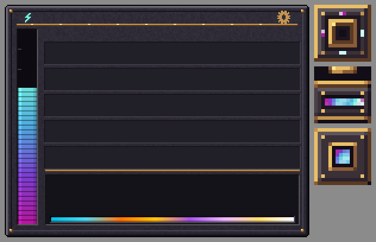
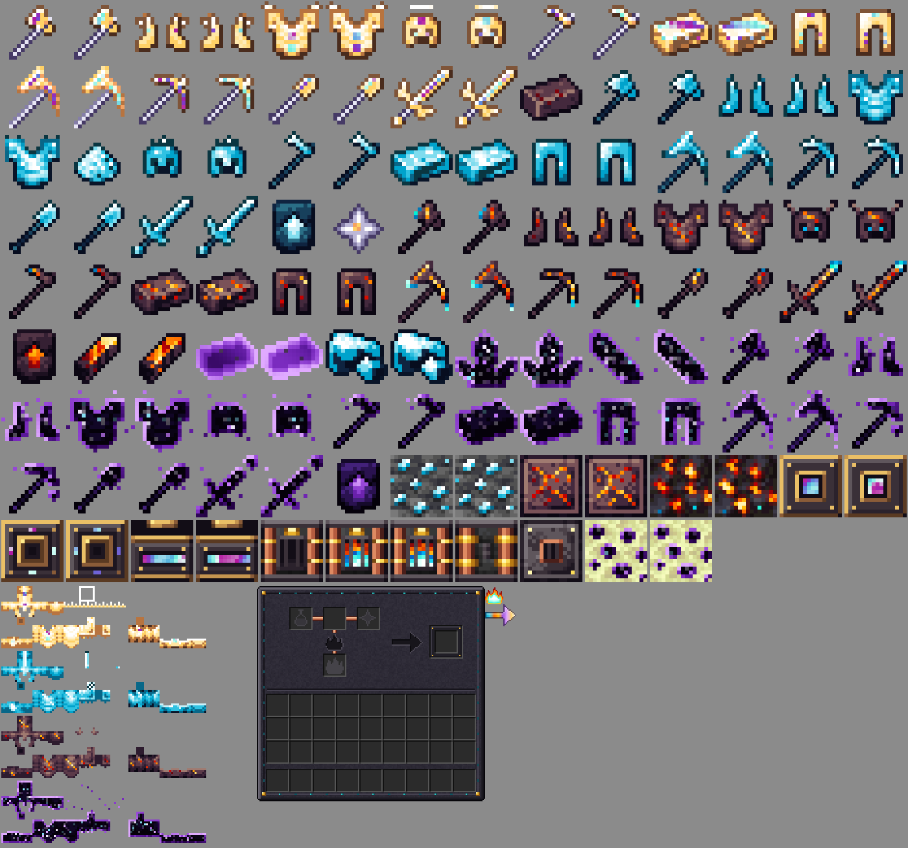

# Cryonite

Мод для **NeoForge 1.21.1** (Minecraft 1.21.1, Java 21). Добавляет четыре каскадных тира снаряжения выше незерита:
**Крионит → Инфернит → Войд → Эфир**. Каждый следующий тир наследует все способности предыдущих.

## Сборка и запуск

```
./gradlew build              # jar в build/libs/
./gradlew runClient          # клиент с модом
./gradlew runData            # перегенерация src/generated/resources
./gradlew runGameTestServer  # 34 серверных GameTest-а (вместе с Create)
```

Готовый jar можно не собирать, а скачать со страницы [Releases](https://github.com/nightmare-huy/Cryonite/releases/latest).

GitHub Actions (`.github/workflows/build.yml`) на каждый push компилирует мод, запускает датаген, сборку и GameTest-ы.
Если всё прошло успешно, jar выкладывается в [Releases](https://github.com/nightmare-huy/Cryonite/releases) — в релиз
`v<mod_version>`, один на версию: каждая новая сборка заменяет в нём файл. Чтобы начать новый релиз, поднимите
`mod_version` в `gradle.properties`.

## Прогрессия

| Тир | Руда | Где | Чем добывать | Как получить слиток |
|---|---|---|---|---|
| Крионит | Крионитовая руда | Верхний мир, Y -64..0 (чаще всего около Y -48), только в глубинном сланце и туфе; больше в холодных биомах и Deep Dark | незеритовая кирка | Плавильня: сырой крионит → кристаллическая пыль → слиток (+ незеритовый лом или осколок эха) |
| Инфернит | Инфернитовая руда | Базальтовые дельты, в оболочке из магмы и чернита | крионитовая кирка | Осколок охладить (синий лёд, котёл с рыхлым снегом или крафт с кристаллической пылью); в плавильне: → заготовка + блок золота + слеза гаста |
| Войд | Руда Войда | Внешние острова Края, Y 0..12 | инфернитовая кирка | Осколки стабилизировать драконьим дыханием → расплавленная заготовка → закалка на плачущем обсидиане или крафт с синим льдом |
| Эфир | — | — | — | Незерит + крионит + инфернит + Войд → неактивный эфир → плавильня с блоком инфернита в качестве топлива |

Крионит, Инфернит и Войд получаются улучшением предыдущего тира в кузнечном столе (шаблоны: Древний город, сокровищница
бастиона, город Края). Эфирное снаряжение крафтится напрямую из слитков.

**Первородная Плавильня** — `OBO / SFS / OBO` (обсидиан, стержень ифрита, незеритовый лом, плавильная печь). Принимает
только особое топливо, своё для каждого рецепта.

## Характеристики

Все числа снаряжения удвоены относительно первой версии мода (единственное место, где они заданы, —
`tier/GearTier.java`). Урон и скорость атаки — итоговые значения из подсказки предмета.

| Тир | Меч | Топор | Кирка | Лопата | Мультитул | Скорость копания | Броня (шлем / нагрудник / поножи / ботинки) | Комплект | Твёрдость комплекта |
|---|---|---|---|---|---|---|---|---|---|
| Крионит | 20 | 24 | 14 | 15 | 22 | 22 | 8 / 16 / 14 / 6 | 44 | 32 |
| Инфернит | 26 | 31 | 17 | 18 | 28 | 28 | 8 / 18 / 14 / 8 | 48 | 40 |
| Войд | 34 | 40 | 20 | 21 | 36 | 36 | 10 / 20 / 16 / 8 | 54 | 52 |
| Эфир | 48 | 56 | 26 | 27 | 50 | 50 | 10 / 22 / 18 / 10 | 60 | 64 |

- Скорость атаки: меч 3.2, топор и лопата 2.0, кирка и мультитул 2.4, мотыга 8.0 (урон мотыги 2).
- Зачаровываемость 36 / 40 / 44 / 50. Сопротивление отбрасыванию: 25 / 30 / 40 / 50 % за предмет брони, то есть
  полный комплект любого тира не отбрасывается вовсе (больше 100 % игра не засчитывает).
- Ванильная игра обрезает броню существа на 30 очках, а твёрдость на 20 — с такими пределами все четыре комплекта
  давали бы одно и то же. Поэтому мод поднимает оба предела до 1024 (`tier/AttributeLimits.java`); это действует и на
  броню из других модов. Шкала брони на экране по-прежнему показывает не больше 10 значков.
- Снаряжение неразрушимо, поэтому удвоенная прочность ни на что не влияет.

## Способности

| Тир | Полный комплект брони | Оружие | Инструменты |
|---|---|---|---|
| Крионит | иммунитет к заморозке и замедлению, ходьба по рыхлому снегу, атакующие замедляются и слабеют | заморозка, +25% по огненным мобам | мгновенно ломают лёд и снег |
| Инфернит | иммунитет к огню, лаве и иссушению, плавание в лаве, атакующие загораются | синее пламя, +25% по нежити, ледяным и водным мобам | автоплавка с Удачей (клавиша `B`) |
| Войд | спасение из пустоты (перезарядка 2 мин), нет урона от падения, маска от эндерменов | игнорирует 30% брони; меч и мультитул: ПКМ — рывок на 7 блоков | телекинез (добыча и опыт сразу в инвентарь) |
| Эфир | креативный полёт, регенерация, иммунитет к негативным эффектам и магии | 50% урона — чистая магия, +1 сердце за удар | копание 3×3 (клавиша `V`) |

Всё снаряжение неразрушимо и не горит.

### Клавиши режимов

| Клавиша | Действие | Кому доступно |
|---|---|---|
| `V` | переключить режим копания 3×3 | эфирные инструменты и Эфирный мультитул |
| `B` | переключить Автоплавку | инструменты и мультитулы от Инфернита и выше |

Клавиши переназначаются в «Управление → Крионит». Нажатие отправляет пакет на сервер: сервер сам проверяет предмет в
основной руке и его тир, переключает режим на своей копии предмета и пишет результат над хотбаром. Текущее состояние и
назначенная клавиша видны в описании инструмента («Автоплавка: ВКЛ [Клавиша: B]», «Режим копания: 3×3 [Клавиша: V]»).
Переключения через Shift + ПКМ больше нет.

Копание 3×3 идёт в плоскости грани, по которой бьёт игрок: сверху или снизу — горизонтальная площадка, сбоку — стена.
Соседний блок ломается, только если инструмент ему подходит и блок вообще разрушаем; сундуки и другие блоки с
содержимым, а также блоки намного прочнее выбранного (обсидиан рядом с камнем) не затрагиваются. Автоплавка и телекинез
действуют на все девять блоков.

### Мультитулы

Кирка, топор, лопата и мотыга в одном предмете, по одному на тир: Крионитовый, Инфернитовый, Мультитул войда, Эфирный.

- Копают всё, что копают кирка, топор, лопата и мотыга, а также листву и паутину — со скоростью тира (22 / 28 / 36 / 50)
  и с тем же уровнем добычи, что у кирки тира.
- Урон на 2 больше, чем у меча тира: 22 / 28 / 36 / 50, скорость атаки 2.4. Сбивают щит, как топор.
- Наследуют все способности оружия и инструментов своего тира.
- ПКМ по блоку: снять кору, счистить окисление или воск (топор), протоптать тропинку или потушить костёр (лопата).
  Shift + ПКМ: вспахать землю (мотыга).
- ПКМ в воздухе у Мультитула войда и Эфирного — рывок. Если прицел наведён на блок, рывка не будет.
- Крафт: `топор лопата кирка / слиток палка слиток` (вместо палки подходит стержень ифрита), всё одного тира.
  Крионитовый мультитул улучшается в кузнечном столе до Инфернитового и дальше до Мультитула войда — теми же шаблонами
  и слитками, что и остальное снаряжение. Эфирный собирается только на верстаке.

## Подсказки и JEI

Каждое сырьё, заготовка, слиток, руда, шаблон и сама Плавильня несут в описании цветные подсказки: откуда предмет
берётся и чем добывается, чем он опасен в инвентаре (цвет тира) и что с ним делать дальше (серым).

С установленным [JEI](https://modrinth.com/mod/jei) (необязателен, версия 19.19.3 и новее) мод добавляет:

- категорию **«Мировая переработка (закалка и стабилизация)»** — котёл с рыхлым снегом, синий лёд, дыхание дракона,
  плачущий обсидиан;
- категорию **«Добыча руд и поиск артефактов»** — измерение, биом, высота и нужная кирка для руд, структуры и шанс
  для кузнечных шаблонов (`R` по руде, сырью или шаблону);
- страницы информации для всех материалов мода.

## Интеграция с Create: Кинетический преобразователь энергии

С установленным [Create](https://modrinth.com/mod/create) (необязателен, версия 6.0.10 и новее для 1.21.1) мод
добавляет блок **«Кинетический преобразователь энергии»** — генератор вращения, работающий на Forge Energy (FE → SU).
Без Create блок не регистрируется, всё остальное в моде работает как обычно.



| Параметр | Значение |
| --- | --- |
| Скорость | 0–8048 RPM, по часовой или против часовой стрелки |
| Мощность (stress capacity) | 1024 SU на каждый RPM — 8 241 152 SU при 8048 RPM |
| Потребление | 4 FE/t на каждый RPM — 32 192 FE/t при 8048 RPM |
| Буфер | 10 000 000 FE, приём до 1 000 000 FE/t |
| Стороны | вал выходит из передней стороны, остальные пять принимают энергию от кабелей любого мода |

- **Крафт** (верстак, рецепт загружается только с Create): слитки крионита, инфернита, Войда и Эфира по углам,
  блок редстоуна сверху, электронная лампа — латунный корпус — вал в среднем ряду, механизм точности снизу.
- **Панель управления** (ПКМ по блоку): поле ввода числа и кнопка «Применить», ползунок, кнопки шага ±1/±10/±100/±1000,
  пресеты `MIN (0)`, `256`, `1024`, `MAX (8048)`, переключатель направления `CW ⟳ / CCW ⟲` и выключатель питания.
  Слева — шкала буфера энергии, внизу — текущая скорость, выход мощности в SU, потребление в FE/t и состояние
  («Работает», «Нет энергии», «Перегрузка», «Простой», «Выключен»).
- Значение проверяет сервер: скорость обрезается до 0–8048 RPM, а менять настройки может только игрок, стоящий рядом
  с блоком. Сеть Create перестраивается через 5 тиков после последнего изменения, поэтому ползунок можно двигать свободно.
- Без энергии генератор останавливается и запускается снова, когда в буфере накопится запас на секунду работы —
  слабый источник не заставит сеть мигать.
- Гаечный ключ Create по-прежнему поворачивает блок, инженерные очки показывают мощность, энергию и потребление.

### Лимит 256 RPM

Лимит скорости в Create — не константа, а серверная настройка `kinetics.maxRotationSpeed` (по умолчанию 256): блок,
который должен вращаться быстрее, ломается. Вместо Mixin-а мод при запуске сервера (и одиночного мира) поднимает эту
настройку до **8048**, если она меньше (`compat/create/KineticSpeedLimit`). Это штатный механизм Create: он
переживает обновления Create и синхронизируется с клиентами. После этого 8048 RPM выдерживают все валы, шестерни,
ремни и механизмы. Значение больше 8048, выставленное владельцем сервера, не трогается.

## Структура

- `src/main/java/dev/nightmarehuy/cryonite/` — код (`registry`, `tier`, `item`, `block`, `recipe`, `menu`, `ability`,
  `event`, `network`, `loot`, `worldgen`, `client`, `compat/jei`, `compat/create`, `datagen`, `gametest`).
  Всё, что обращается к классам Create, лежит в `compat/create` и загружается только при установленном Create.
- `src/generated/resources/` — результат `runData`, руками не редактируется.
- `tools/generate_hd_pixelart.py` — генератор всех текстур (предметы, блоки, броня на игроке, GUI) и их
  `.png.mcmeta`; нужны Pillow и numpy. Ванильные текстуры (фон руд, шейдинг незеритовой брони и т. п.) скрипт берёт
  из кэша Gradle после первой сборки или из пути `--vanilla <папка или jar>`.

## Текстуры



Перегенерация: `python tools/generate_hd_pixelart.py --preview docs/textures.png`.
Иконки мультитулов рисует тот же скрипт (`MULTITOOL_BASE` и `multitool_grids()`), все четыре анимированы: общий
силуэт — широкое лезвие топора слева сверху и дуга кирки справа на диагональной рукояти, тир добавляет свои детали.
Текстуры преобразователя (три грани блока и лист GUI 512×256) и обзорный лист `docs/kinetic_converter.png` —
секция `Kinetic Energy Converter` того же скрипта.
